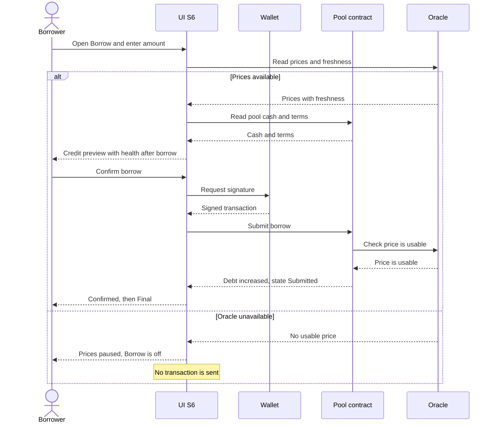

# Borrow sequence: credit preview, then borrow

Covers the credit preview on S6, the borrow transaction, and the oracle-unavailable branch.

Notes

- If the oracle fails between the preview and the submit, the pool refuses the borrow (fail closed) and the UI shows Reverted with the reason.
- Thresholds that set Watch, At risk and Liquidatable come from the pool settings. They are not shown here.
