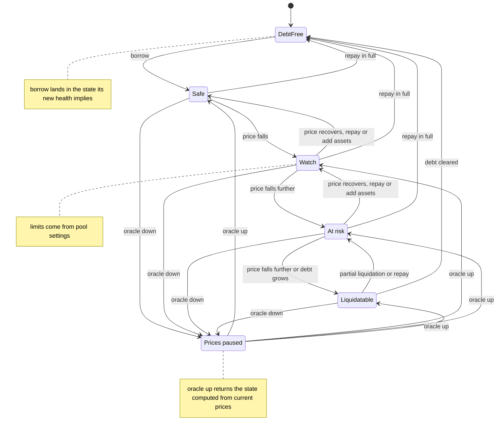

# Account health states

States of one account's health, and the events that move it between states.

Notes

- Thresholds for Watch, At risk and Liquidatable come from the pool settings. No numbers are given here.
- Repay, adding assets and price moves are the events that change the state. Repay is always allowed. Adding assets is always allowed.
- While Prices paused is shown, Borrow and withdrawing while in debt are off.
- Open question: whether a debt-free account ever shows Prices paused. The diagram follows the debt states only.
