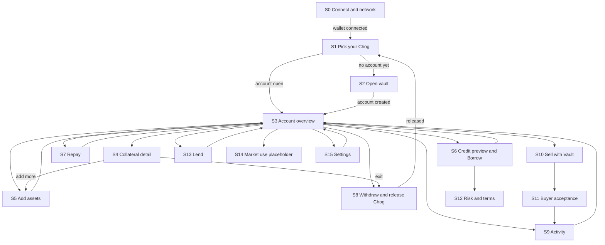

# Screen map

Navigation between the 16 screens (S0 to S15). Each node is one screen. Arrows show the main navigation.

Notes

- S14 is a placeholder. It is not available yet.
- S0 is the entry point. Settings (S15) is also reachable from S0.
- Screens S6, S7 and S8 show the special states Prices paused, At risk, Liquidatable, error and pending in place. They are not separate screens.
