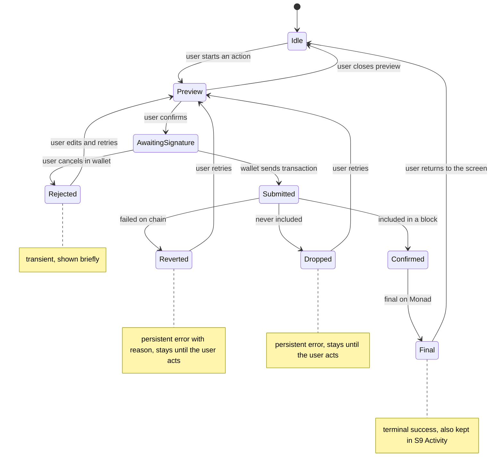

# Transaction states in the UI

How one transaction moves through the UI, from preview to a final result.

## Persistent and transient states

| State | Type | Notes |
|---|---|---|
| Idle | Resting | No transaction in progress. |
| Preview | Transient | Shows the numbers before signing. |
| AwaitingSignature | Transient | Waiting for the wallet. |
| Submitted | Transient | Sent. Shown as pending until it is confirmed. |
| Confirmed | Transient | Included. Final is still to come (Monad has speculative finality). |
| Final | Terminal success | Kept in S9 Activity. |
| Rejected | Transient | The user cancelled in the wallet. No error is kept. |
| Reverted | Persistent error | Shows the reason. Stays until the user retries or dismisses it. |
| Dropped | Persistent error | Not included. Stays until the user retries or dismisses it. |
